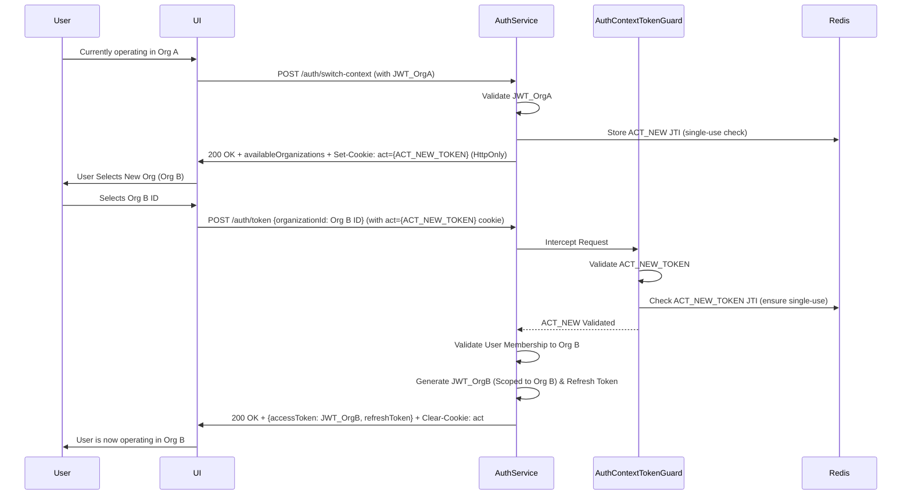

# Authentication Flow: Context Switching

The Verichron platform allows users who are members of multiple organizations to seamlessly switch between their organization contexts without needing to log out and log back in. This feature is designed to enhance user experience while maintaining the strong security posture of scoped JWTs.

## 1. Overview of Context Switching

-   **Purpose**: To enable users with memberships in multiple organizations to obtain a new, scoped JWT for a different organization they belong to, without re-authenticating their credentials.
-   **Mechanism**: The process mirrors the two-step login flow: the user first obtains a temporary Authentication Context Token (ACT), then exchanges it for a new JWT scoped to the desired organization.
-   **Security**: Permissions are always recalculated for the newly selected organization, preventing privilege escalation or permission bleed across contexts.

## 2. Context Switching Flow

1.  **Authenticated Request**: The user is already authenticated with an active JWT (e.g., scoped to Org A).
2.  **Initiate Switch (`POST /auth/switch-context`)**: The client makes a request to this endpoint with the current valid JWT.
3.  **New ACT Issuance**: The `api-users` service validates the current JWT and, if valid, issues a *new* short-lived ACT (Authentication Context Token) as an `HttpOnly` cookie. It also returns the full list of organizations the user is a member of.
4.  **Organization Selection**: The client (UI) receives the ACT and the list of organizations. The user selects a new `organizationId` (e.g., Org B) from this list.
5.  **New Scoped Token Issuance (`POST /auth/token`)**: The client sends the new `organizationId` to the `POST /auth/token` endpoint. This request automatically includes the newly issued ACT cookie.
6.  **Validation & JWT Generation**: The `AuthContextTokenGuard` validates the ACT. The `api-users` service then validates the user's membership in the *newly requested organization* (Org B) and issues a new JWT (access token and refresh token) scoped specifically to Org B. The ACT cookie is cleared.

## 3. Sequence Diagram

## 4. Key Considerations

-   **Permission Recalculation**: When a user switches context, the new JWT will contain the roles and permissions specific to their membership in the *newly selected organization*. This prevents a user from carrying privileges from one organization to another.
-   **Event Publishing**: A `ContextSwitched` event is published, including `fromOrganizationId` and `toOrganizationId`, which is valuable for audit trails and analytics.
-   **Unauthorized Access Prevention**: The system strictly prevents switching to organizations the user is not a member of. Attempts to do so will result in a `401 Unauthorized` response.
-   **Debtor Users**: Debtor users typically do not require context switching as their JWTs are designed for multi-organization access from the start, containing an array of `organizationIds`.
