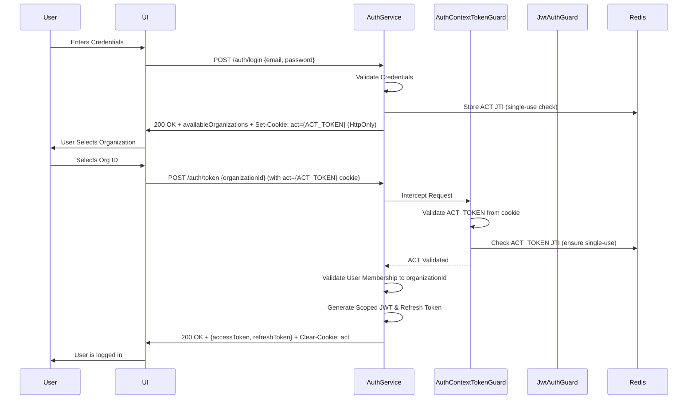

# Authentication Flow: Two-Step Login

The Verichron platform implements a robust and secure two-step authentication process designed to enhance security, especially in a multi-tenant environment. This flow separates initial credential validation from the issuance of a tenant-scoped access token.

## 1. Overview of the Two-Step Login

This flow is critical for a multi-tenant FinTech application as it prevents lateral movement attacks by ensuring the primary access token is always explicitly scoped to a single organization.

-   **Step 1: Credentials Authentication (`POST /auth/login`)**
    -   The user authenticates with standard credentials (email and password).
    -   The service validates these credentials.
    -   Instead of an immediate JWT, the service returns a list of the user's associated organizations.
    -   A short-lived (e.g., 5 minutes), `httpOnly`, `secure`, `sameSite: 'strict'` cookie named `act` (Authentication Context Token) is set.
    -   **Security Benefit:** The `httpOnly` flag prevents client-side scripts from accessing this token, mitigating XSS risks. Its short lifespan limits utility if compromised.

-   **Step 2: Scoped Token Issuance (`POST /auth/token`)**
    -   The client (UI) receives the list of organizations from Step 1.
    -   The user selects an organization, and the client sends the chosen `organizationId` to this endpoint.
    -   The request is protected by an `AuthContextTokenGuard`, which validates the `act` cookie.
    -   Upon successful validation, the service issues the final scoped JWT (access token) and a refresh token.
    -   The `act` cookie is then cleared.
    -   **Security Benefit:** This ensures the primary access token is explicitly scoped, preventing horizontal privilege escalation across tenants.

## 2. Sequence Diagram

## 3. Key Security Features of ACT Token Validation

The `act` token validation mechanism, implemented in `auth/strategies/act.strategy.ts`, is robust:

-   **JWT-based:** The `act` token is itself a standard JWT.
-   **Secure Extraction:** The token is extracted securely from the `httpOnly` cookie.
-   **Isolated Secret:** It is signed and verified using a dedicated `AUTH_CONTEXT_TOKEN_SECRET`, preventing cross-token forgery.
-   **Strict Expiration:** Enforces a short lifespan (e.g., 5 minutes) to reduce the attack window.
-   **Single-Use:** After a successful exchange for a session JWT, the `act` token's unique identifier (`jti`) is stored in Redis with a short TTL, "burning" the token and preventing replay attacks.

This two-step authentication process forms a strong security posture, separating initial authentication from session token issuance and significantly reducing the attack surface.
