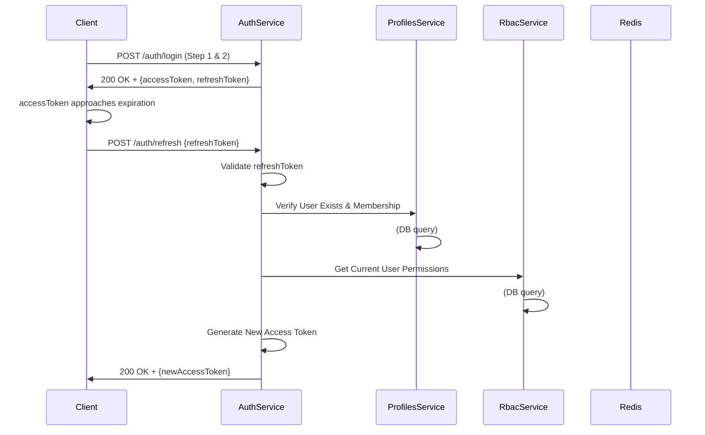

# Authentication Flow: Token Refresh

The Verichron platform implements a standard JWT refresh token mechanism to allow users to maintain long-running sessions without needing to frequently re-authenticate. This balances security (short-lived access tokens) with user experience (persistent sessions).

## 1. Overview of the Token Refresh Mechanism

-   **Purpose**: To obtain a new, valid access token without requiring the user to re-enter their credentials. This is crucial for maintaining user sessions beyond the short lifespan of access tokens.
-   **Access Token (JWT)**: Short-lived (e.g., 15 minutes), used for authenticating most API requests. If compromised, its short lifespan limits exposure.
-   **Refresh Token**: Long-lived (e.g., 7 days), used *only* to obtain new access tokens. It is sent less frequently and should be stored more securely (e.g., HttpOnly cookie).

## 2. Token Refresh Flow

1.  **Initial Authentication**: After the two-step login process, the client receives both an `accessToken` and a `refreshToken`.
2.  **Access Token Expiration**: When the `accessToken` approaches expiration (or if a request fails with a `401 Unauthorized` due to an expired token), the client initiates the refresh flow.
3.  **Refresh Request**: The client sends the `refreshToken` to the `POST /auth/refresh` endpoint.
4.  **Validation & Re-issuance**: The `api-users` service validates the `refreshToken`.
    -   It checks the `refreshToken` for validity and expiration.
    -   Crucially, it re-validates the user's existence and, if the user is an organization member, re-fetches their current permissions from the `RbacService`. This ensures that any privilege changes (e.g., a user being removed from an organization or having their role changed) are reflected promptly in the newly issued access token.
    -   It then issues a new `accessToken` (and potentially a new `refreshToken`, depending on the rotation strategy).

## 3. Sequence Diagram

## 4. Key Security & Design Considerations

-   **Short-Lived Access Tokens**: Reduces the impact of a compromised access token.
-   **Dynamic Permission Recalculation**: Permissions embedded in the new access token are always up-to-date, reflecting any changes in the user's roles or memberships since the last login. This is a critical security feature.
-   **Validation on Refresh**: The system does not blindly trust the `refreshToken`. It performs checks to ensure the user still exists and is authorized.
-   **Non-Rotated Refresh Tokens (Current Implementation)**: The current implementation reuses the same `refreshToken` until it expires. While more secure implementations might issue a new `refreshToken` with each refresh (rotation), this approach simplifies concurrency and multi-device scenarios. This is a deliberate trade-off.
-   **Monitoring**: The refresh endpoint is a critical path for session maintenance and should be monitored for performance and security anomalies.
