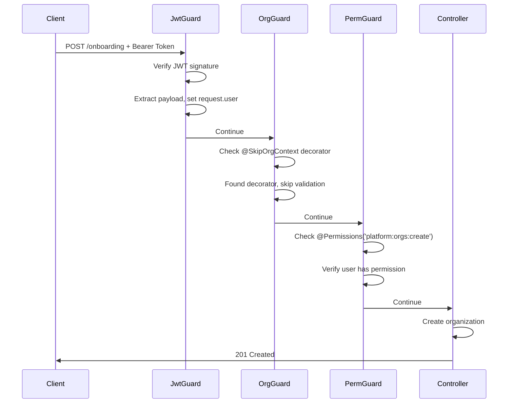
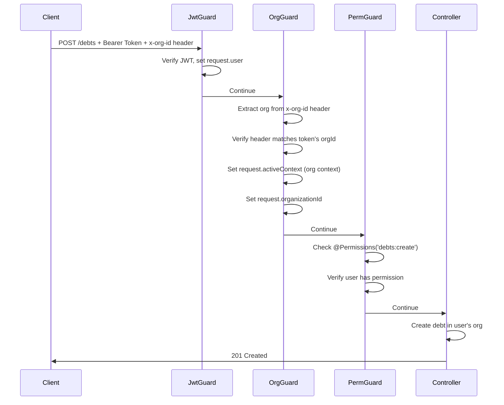
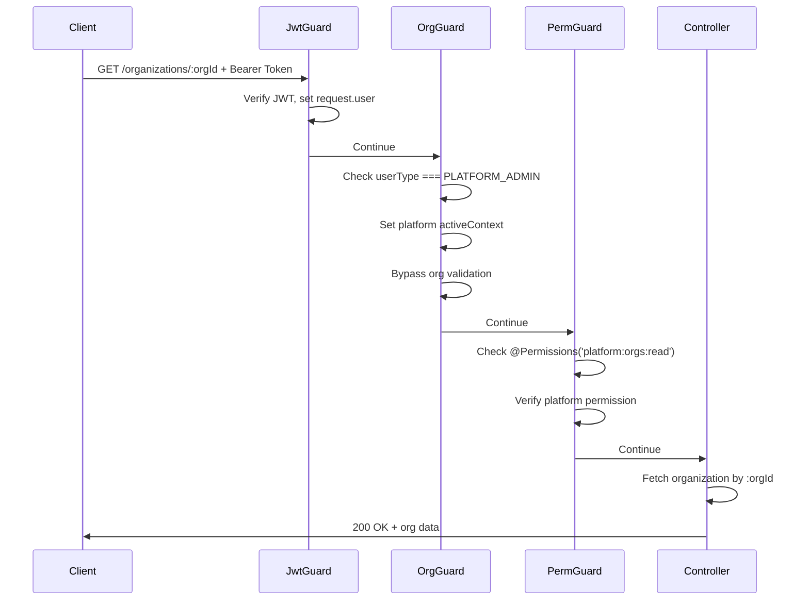
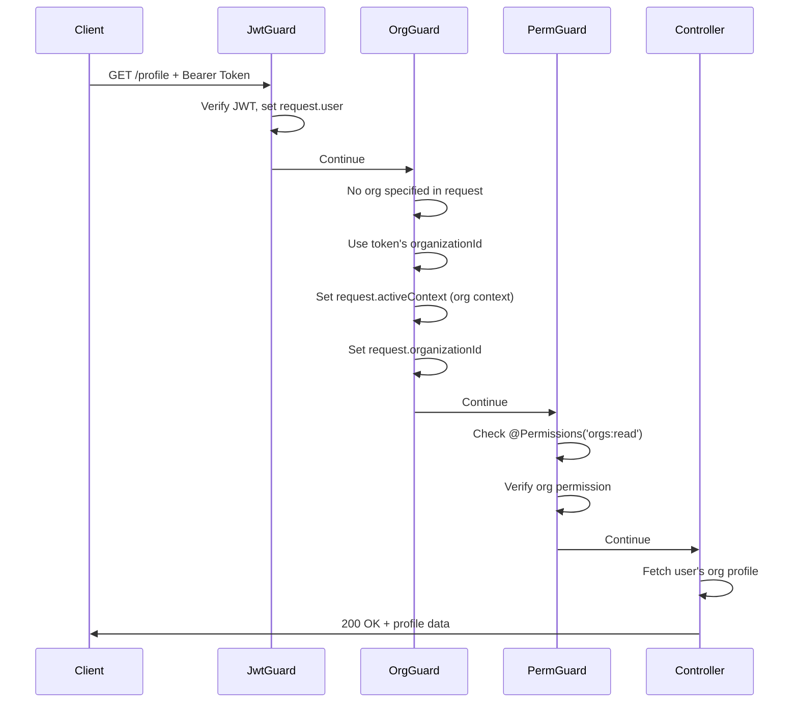

# Authentication & Authorization Architecture

**Version:** 1.0
**Last Updated:** 2025-10-30
**Status:** Production
**Critical Security Component**

---

## Table of Contents

1. [Overview](#overview)
2. [User Types](#user-types)
3. [Roles & Permissions](#roles--permissions)
4. [JWT Token Structure](#jwt-token-structure)
5. [Guard Chain Architecture](#guard-chain-architecture)
6. [Complete Auth Flows](#complete-auth-flows)
7. [Microservice Integration Patterns](#microservice-integration-patterns)
8. [Use Cases](#use-cases)
9. [RBAC Strategy](#rbac-strategy)
10. [How to Update/Extend](#how-to-updateextend)
11. [Testing Strategy](#testing-strategy)

---

## Overview

The Verichron platform uses a **multi-tenant, role-based access control (RBAC)** system that supports two distinct user types:

- **Platform Admins**: System-level users with cross-organization privileges
- **Organization Users**: Tenant-scoped users with organization-specific access

### Design Principles

1. **Type Safety First**: Discriminated union types prevent mixing platform/org contexts at compile-time
2. **Defense in Depth**: Layered guard architecture with JWT → OrgContext → Permissions validation
3. **Fail Secure**: All access is denied by default; explicit grants required
4. **Audit Trail**: All authorization decisions are logged with full context
5. **Stateless**: JWT contains all authorization data; no session state required

---

## User Types

### Platform Admin (`UserType.PLATFORM_ADMIN`)

**Purpose**: System administrators with unrestricted access across all organizations

**Characteristics**:
- `organizationId: null` in JWT claims
- Bypasses organization context validation
- Has platform-level roles and permissions
- Can access any organization's resources
- Used for system maintenance, onboarding, and cross-tenant operations

**Example JWT Claims**:
```typescript
{
  sub: "platform-admin-uuid",
  userType: UserType.PLATFORM_ADMIN,
  "https://verichroninc.com/claims": {
    organizationId: null,
    platformRoles: ["PLATFORM_ADMIN"],
    platformPermissions: [
      "platform:orgs:create",
      "platform:orgs:read",
      "platform:orgs:update",
      "platform:orgs:delete",
      "platform:users:manage"
    ]
  }
}
```

### Organization User (`UserType.ORGANIZATION_USER`)

**Purpose**: Regular tenant users with scoped access to their organization

**Characteristics**:
- `organizationId: <uuid>` in JWT claims
- Must match organization context in requests
- Has organization-level roles and permissions
- Cannot access other organizations' resources
- Used for normal business operations

**Example JWT Claims**:
```typescript
{
  sub: "user-uuid",
  userType: UserType.ORGANIZATION_USER,
  "https://verichroninc.com/claims": {
    organizationId: "org-uuid-123",
    roles: ["ADMIN", "COLLECTIONS_MANAGER"],
    permissions: [
      "orgs:read",
      "orgs:update",
      "debts:create",
      "debts:read",
      "debts:update",
      "portfolios:manage"
    ]
  }
}
```

---

## Roles & Permissions

### Platform Roles

**Enum**: `PlatformRole` (in `@verichron/types/src/enums/auth/platform-roles.enum.ts`)

| Role | Description | Typical Use |
|------|-------------|-------------|
| `PLATFORM_ADMIN` | Full system access | DevOps, support engineers |

**Platform Permissions**: Fine-grained platform-level operations

```typescript
// PlatformPermission enum values
"platform:orgs:create"    // Provision new organizations
"platform:orgs:read"      // View all organizations
"platform:orgs:update"    // Modify organization settings
"platform:orgs:delete"    // Remove organizations
"platform:orgs:suspend"   // Suspend organization access
"platform:users:manage"   // Manage platform admin users
"platform:metrics:view"   // Access system-wide analytics
```

### Organization Roles

**Enum**: `OrganizationRole` (in `@verichron/types/src/enums/organizations/organization-roles.enum.ts`)

| Role | Description | Permissions |
|------|-------------|-------------|
| `OWNER` | Organization owner | Full organization access |
| `ADMIN` | Organization administrator | All except billing/deletion |
| `COLLECTIONS_MANAGER` | Debt collection management | Manage debts, portfolios, workflows |
| `ANALYST` | Read-only analyst | View reports and analytics |
| `MEMBER` | Basic user | Limited read access |

**Organization Permissions**: Fine-grained organization-level operations

```typescript
// OrganizationPermission enum values
// Organization Management
"orgs:read"
"orgs:update"
"orgs:members:invite"
"orgs:members:manage"
"orgs:settings:manage"

// Debt Management
"debts:create"
"debts:read"
"debts:update"
"debts:delete"
"debts:import"
"debts:export"

// Portfolio Management
"portfolios:create"
"portfolios:read"
"portfolios:update"
"portfolios:delete"
"portfolios:share"

// Analytics
"analytics:view"
"analytics:export"
```

---

## JWT Token Structure

### Token Format

```typescript
interface JWTPayload {
  // Standard JWT claims
  sub: string;                    // User ID
  iat: number;                    // Issued at (Unix timestamp)
  exp: number;                    // Expiration (Unix timestamp)

  // Verichron custom claims
  userType: UserType;             // PLATFORM_ADMIN | ORGANIZATION_USER

  // Custom claims namespace
  [JWT_CLAIMS_NAMESPACE]: CustomJWTClaims;
}

const JWT_CLAIMS_NAMESPACE = "https://verichroninc.com/claims";

interface CustomJWTClaims {
  organizationId: string | null;  // null for platform admins

  // Platform admin fields
  platformRoles?: PlatformRole[];
  platformPermissions?: PlatformPermission[];

  // Organization user fields
  roles?: OrganizationRole[];
  permissions?: OrganizationPermission[];
}
```

### Active Context Type (Set by Guards)

The `OrgContextGuard` sets `request.activeContext` as a **discriminated union** for type-safe downstream usage:

```typescript
type ActiveContext = PlatformAdminContext | OrganizationUserContext;

interface PlatformAdminContext {
  orgId: null;                           // Discriminator
  roles: PlatformRole[];
  permissions: PlatformPermission[];
}

interface OrganizationUserContext {
  orgId: string;                         // Discriminator
  roles: OrganizationRole[];
  permissions: OrganizationPermission[];
}
```

**TypeScript Narrowing Example**:
```typescript
if (request.activeContext.orgId === null) {
  // TypeScript knows this is PlatformAdminContext
  const platformPerms: PlatformPermission[] = request.activeContext.permissions;
} else {
  // TypeScript knows this is OrganizationUserContext
  const orgPerms: OrganizationPermission[] = request.activeContext.permissions;
  const orgId: string = request.activeContext.orgId;
}
```

---

## Guard Chain Architecture

### Guard Execution Order

```
1. JwtAuthGuard (or JwtStrategy)
   ↓ Validates JWT signature and expiration
   ↓ Attaches user payload to request.user
   ↓
2. OrgContextGuard
   ↓ Validates organization context
   ↓ Sets request.activeContext (PlatformAdminContext | OrganizationUserContext)
   ↓ Sets request.organizationId (for org users)
   ↓
3. PermissionsGuard
   ↓ Validates required permissions from @Permissions() decorator
   ↓ Uses request.activeContext to check permissions
   ↓
4. Controller/Service Logic
```

### Guard Implementations

#### 1. JwtAuthGuard / JwtStrategy

**Location**:
- `apps/api-users/src/auth/strategies/jwt.strategy.ts`
- `apps/api-organizations/src/common/guards/jwt.guard.ts`

**Responsibility**: Validate JWT and populate `request.user`

**How to Apply**:
```typescript
// Option 1: Apply globally (recommended)
// In app.module.ts:
{
  provide: APP_GUARD,
  useClass: JwtAuthGuard,
}

// Option 2: Opt-out with @Public() decorator
@Get('health')
@Public()
async healthCheck() { }
```

#### 2. OrgContextGuard

**Location**:
- `apps/api-users/src/core/guards/org-context.guard.ts`
- `apps/api-organizations/src/common/guards/org-context.guard.ts`

**Responsibility**:
1. Extract organization ID from request (header, params, or body)
2. Validate user has access to that organization
3. Set `request.activeContext` and `request.organizationId`

**Organization ID Extraction Priority**:
```typescript
const requestedOrgId =
  request.headers['x-org-id'] ||           // Priority 1: Header
  request.params?.orgId ||                 // Priority 2: Route param
  request.params?.organizationId ||        // Priority 3: Alternative param
  request.body?.organizationId;            // Priority 4: Body field

// If no org specified, use token's organizationId (for org users)
```

**Validation Logic**:

```typescript
// Platform Admins
if (user.userType === UserType.PLATFORM_ADMIN) {
  // Set platform context
  request.activeContext = {
    orgId: null,
    roles: claims.platformRoles || [],
    permissions: claims.platformPermissions || []
  };
  return true; // Bypass org checks
}

// Organization Users
const userOrgId = claims.organizationId;
const requestedOrgId = /* extract from request */;

if (requestedOrgId && requestedOrgId !== userOrgId) {
  throw new ForbiddenException('Access denied');
}

// Set org context
request.activeContext = {
  orgId: userOrgId,
  roles: claims.roles || [],
  permissions: claims.permissions || []
};
request.organizationId = userOrgId;
```

**How to Apply**:
```typescript
// Apply globally
{
  provide: APP_GUARD,
  useClass: OrgContextGuard,
}

// Opt-out with @SkipOrgContext()
@Post('onboarding')
@SkipOrgContext()
@Permissions('platform:orgs:create')
async provisionOrganization(@Body() dto: ProvisionOrganizationDto) { }
```

**When to Use @SkipOrgContext()**:
- Platform admin endpoints that operate outside org context
- System-wide aggregations or reports
- Cross-organization operations
- Organization provisioning (no org exists yet)

#### 3. PermissionsGuard

**Location**:
- `apps/api-users/src/core/guards/permissions.guard.ts`
- `apps/api-organizations/src/common/guards/permissions.guard.ts`

**Responsibility**: Verify user has required permissions from `@Permissions()` decorator

**Implementation**:
```typescript
canActivate(context: ExecutionContext): boolean {
  const requiredPermissions = this.reflector.get<Permission[]>(
    PERMISSIONS_KEY,
    context.getHandler()
  );

  if (!requiredPermissions) return true;

  const request = context.switchToHttp().getRequest();
  const activeContext = request.activeContext;

  if (!activeContext) {
    throw new ForbiddenException('No active context');
  }

  // Check if user has ALL required permissions
  const hasPermissions = requiredPermissions.every(required =>
    activeContext.permissions.includes(required)
  );

  if (!hasPermissions) {
    throw new ForbiddenException('Insufficient permissions');
  }

  return true;
}
```

**How to Apply**:
```typescript
// Apply globally
{
  provide: APP_GUARD,
  useClass: PermissionsGuard,
}

// Use decorator on endpoints
@Post()
@Permissions('debts:create')
async createDebt(@Body() dto: CreateDebtDto) { }

// Multiple permissions (ALL required)
@Delete(':id')
@Permissions('debts:delete', 'portfolios:manage')
async deleteDebt(@Param('id') id: string) { }
```

---

## Complete Auth Flows

### Flow 1: Platform Admin Onboarding New Organization



**Code Example**:
```typescript
@Controller('onboarding')
export class OnboardingController {
  @Post()
  @SkipOrgContext()                           // Skip org validation
  @Permissions('platform:orgs:create')        // Require platform permission
  async provisionOrganization(
    @Body() dto: ProvisionOrganizationDto
  ) {
    return this.onboardingService.provisionOrganization(dto);
  }
}
```

### Flow 2: Organization User Creating Debt



**Code Example**:
```typescript
@Controller('debts')
export class DebtsController {
  @Post()
  @Permissions('debts:create')                // Require org permission
  async createDebt(
    @Body() dto: CreateDebtDto,
    @OrganizationId() orgId: string           // Injected from request.organizationId
  ) {
    return this.debtsService.createDebt(orgId, dto);
  }
}
```

### Flow 3: Platform Admin Accessing Any Organization



**Code Example**:
```typescript
@Controller('organizations')
export class ProfilesController {
  @Get(':orgId')
  @Permissions('platform:orgs:read')          // Platform permission
  async getOrganization(
    @Param('orgId') orgId: string
  ) {
    // Platform admin can access any orgId
    return this.profilesService.findOneOrganization(orgId);
  }
}
```

### Flow 4: Organization User Accessing Own Organization



**Code Example**:
```typescript
@Controller('profile')
export class ProfilesController {
  @Get()
  @Permissions('orgs:read')
  async getMyProfile(
    @OrganizationId() orgId: string,          // Auto-populated from token
    @CurrentUserId() userId: string
  ) {
    return this.profilesService.getUserProfile(orgId, userId);
  }
}
```

---

## Microservice Integration Patterns

### Pattern 1: Synchronous HTTP with Header Propagation

**Use Case**: Service A calls Service B and needs to preserve auth context

**Implementation**:
```typescript
// In Service A (api-organizations)
@Injectable()
export class AnalyticsService {
  constructor(private httpService: HttpService) {}

  async getDebtMetrics(orgId: string, request: Request): Promise<DebtMetrics> {
    // Forward authorization context
    const headers = {
      'Authorization': request.headers.authorization,  // JWT token
      'x-org-id': orgId,                               // Org context
    };

    const response = await this.httpService.axiosRef.get(
      `${DEBTS_SERVICE_URL}/analytics/metrics`,
      { headers }
    );

    return response.data;
  }
}

// In Service B (api-debts)
@Controller('analytics')
export class AnalyticsController {
  @Get('metrics')
  @Permissions('debts:read')                    // Validates forwarded token
  async getMetrics(
    @OrganizationId() orgId: string             // Validates x-org-id header
  ) {
    return this.analyticsService.getMetrics(orgId);
  }
}
```

**Guard Chain in Service B**:
1. JwtGuard validates the forwarded Authorization header
2. OrgContextGuard validates x-org-id matches token
3. PermissionsGuard checks 'debts:read' permission

### Pattern 2: Event-Driven with Embedded Context

**Use Case**: Service A publishes event that Service B consumes

**Implementation**:
```typescript
// In Service A (api-organizations)
@Injectable()
export class OnboardingService {
  async provisionOrganization(dto: ProvisionOrganizationDto, user: JWTPayload) {
    const org = await this.createOrganization(dto);

    // Embed auth context in event
    await this.eventPublisher.publish('organization.created', {
      organizationId: org.id,
      organizationName: org.name,
      metadata: {
        createdBy: user.sub,                    // Platform admin ID
        createdByType: user.userType,           // PLATFORM_ADMIN
        timestamp: new Date().toISOString()
      }
    });

    return org;
  }
}

// In Service B (api-users)
@EventSubscriber('organization.created')
export class OrganizationCreatedListener {
  async handleEvent(payload: OrganizationCreatedEvent) {
    // Event processing doesn't go through HTTP guard chain
    // Validate event structure and metadata instead

    if (!payload.organizationId || !payload.metadata?.createdBy) {
      throw new Error('Invalid event payload');
    }

    // Create default membership for the creator
    await this.profilesService.createMembership({
      userId: payload.metadata.createdBy,
      organizationId: payload.organizationId,
      role: OrganizationRole.OWNER
    });
  }
}
```

**Event Security Considerations**:
- Events bypass HTTP guard chain
- Validate event structure and required fields
- Consider signing events or using internal service tokens
- Log all event processing for audit trail

### Pattern 3: Service-to-Service with Internal Tokens

**Use Case**: Background job or cron task needs to access protected resources

**Implementation**:
```typescript
// System service account (stored securely)
const SYSTEM_SERVICE_TOKEN = process.env.INTERNAL_SERVICE_TOKEN;

@Injectable()
export class ScheduledTasksService {
  async cleanupExpiredSessions() {
    // Use internal service token for background operations
    const headers = {
      'Authorization': `Bearer ${SYSTEM_SERVICE_TOKEN}`,
      'x-org-id': 'SYSTEM',                     // Special system context
    };

    await this.httpService.axiosRef.delete(
      `${USERS_SERVICE_URL}/sessions/expired`,
      { headers }
    );
  }
}

// Receiving service validates internal token
@Delete('sessions/expired')
@SkipOrgContext()                               // System operation
@Permissions('platform:sessions:manage')
async cleanupExpiredSessions() {
  // Only callable with internal service token
  return this.sessionsService.deleteExpired();
}
```

---

## Use Cases

### UC-1: Platform Admin Provisions New Organization

**Actors**: Platform Admin
**Endpoint**: `POST /onboarding`
**Required Permission**: `platform:orgs:create`

**Flow**:
1. Platform admin authenticates, receives JWT with `userType: PLATFORM_ADMIN`
2. Admin calls POST /onboarding with organization details
3. `@SkipOrgContext()` decorator bypasses org validation (no org exists yet)
4. `@Permissions('platform:orgs:create')` validates platform permission
5. Service creates organization in database
6. Event `organization.created` published to other services
7. api-users service creates owner membership

**Security Checks**:
- JWT signature validation
- Platform admin userType check
- Platform permission check
- Event contains creator audit trail

### UC-2: Organization Owner Invites Team Member

**Actors**: Organization Owner
**Endpoint**: `POST /organizations/:orgId/members`
**Required Permission**: `orgs:members:invite`

**Flow**:
1. Owner authenticates, receives JWT with their organizationId
2. Owner calls POST with `x-org-id: <their-org-id>` header
3. OrgContextGuard validates header matches token's orgId
4. PermissionsGuard checks `orgs:members:invite` permission
5. Service creates invitation or membership
6. Email sent to invitee

**Security Checks**:
- JWT signature validation
- Organization context validation (header matches token)
- Organization permission check
- Cannot invite to other organizations

### UC-3: Collections Manager Creates Debt Portfolio

**Actors**: Collections Manager
**Endpoint**: `POST /portfolios`
**Required Permissions**: `portfolios:create`

**Flow**:
1. Manager authenticates with their org JWT
2. Manager calls POST /portfolios
3. No explicit orgId in request, so token's orgId used
4. PermissionsGuard validates `portfolios:create` permission
5. Service creates portfolio in manager's organization
6. Portfolio only accessible to same organization

**Security Checks**:
- JWT validation
- Organization context auto-populated from token
- Permission validation
- Portfolio scoped to organization

### UC-4: Analyst Views Organization Dashboard

**Actors**: Analyst
**Endpoint**: `GET /analytics/dashboard`
**Required Permission**: `analytics:view`

**Flow**:
1. Analyst authenticates with read-only JWT
2. Analyst calls GET /analytics/dashboard
3. OrgContextGuard uses token's orgId
4. PermissionsGuard validates `analytics:view` permission
5. Service aggregates data from multiple microservices
6. Each service validates org context independently

**Security Checks**:
- JWT validation
- Org context propagated to all services via x-org-id header
- Permission check prevents write operations
- Data filtered to analyst's organization only

### UC-5: Platform Admin Suspends Organization

**Actors**: Platform Admin
**Endpoint**: `PATCH /organizations/:orgId/suspend`
**Required Permission**: `platform:orgs:suspend`

**Flow**:
1. Platform admin authenticates
2. Admin calls PATCH with target orgId
3. OrgContextGuard sees platform admin, bypasses org check
4. PermissionsGuard validates `platform:orgs:suspend` permission
5. Service marks organization as suspended
6. Event `organization.suspended` published
7. All services revoke access for org users

**Security Checks**:
- Platform admin validation
- Platform permission check
- Audit event published
- Org users immediately lose access

---

## RBAC Strategy

### Current Implementation

**Two-Tier RBAC**:
1. **Platform Tier**: Platform admins with system-wide access
2. **Organization Tier**: Organization users with tenant-scoped access

**Permission Model**: Fine-grained permissions assigned to roles

### Role-Permission Mapping

#### Platform Roles → Permissions

```typescript
const PLATFORM_ROLE_PERMISSIONS: Record<PlatformRole, PlatformPermission[]> = {
  PLATFORM_ADMIN: [
    'platform:orgs:create',
    'platform:orgs:read',
    'platform:orgs:update',
    'platform:orgs:delete',
    'platform:orgs:suspend',
    'platform:users:manage',
    'platform:metrics:view'
  ]
};
```

#### Organization Roles → Permissions

```typescript
const ORG_ROLE_PERMISSIONS: Record<OrganizationRole, OrganizationPermission[]> = {
  OWNER: [
    'orgs:read', 'orgs:update', 'orgs:members:invite', 'orgs:members:manage',
    'orgs:settings:manage', 'debts:create', 'debts:read', 'debts:update',
    'debts:delete', 'debts:import', 'debts:export', 'portfolios:create',
    'portfolios:read', 'portfolios:update', 'portfolios:delete',
    'portfolios:share', 'analytics:view', 'analytics:export'
  ],

  ADMIN: [
    'orgs:read', 'orgs:update', 'orgs:members:invite', 'orgs:members:manage',
    'debts:create', 'debts:read', 'debts:update', 'debts:delete',
    'debts:import', 'debts:export', 'portfolios:create', 'portfolios:read',
    'portfolios:update', 'portfolios:delete', 'analytics:view', 'analytics:export'
  ],

  COLLECTIONS_MANAGER: [
    'orgs:read', 'debts:create', 'debts:read', 'debts:update',
    'debts:import', 'portfolios:create', 'portfolios:read',
    'portfolios:update', 'analytics:view'
  ],

  ANALYST: [
    'orgs:read', 'debts:read', 'portfolios:read', 'analytics:view', 'analytics:export'
  ],

  MEMBER: [
    'orgs:read', 'debts:read', 'portfolios:read'
  ]
};
```

### Permission Assignment Flow

```typescript
// When user is created/invited
async assignRole(userId: string, orgId: string, role: OrganizationRole) {
  // 1. Get permissions for role
  const permissions = ORG_ROLE_PERMISSIONS[role];

  // 2. Store in database
  await this.db.userMemberships.upsert({
    userId,
    organizationId: orgId,
    role,
    permissions                // Denormalized for performance
  });

  // 3. Future: Trigger JWT refresh
}
```

### Future: Custom Permissions

**Current**: Permissions are hardcoded per role
**Future**: Allow custom permission assignments per user

```typescript
// Future schema
interface UserMembership {
  userId: string;
  organizationId: string;
  role: OrganizationRole;
  customPermissions?: OrganizationPermission[];  // Overrides/extends role perms
}

// Future permission resolution
function getUserPermissions(membership: UserMembership): OrganizationPermission[] {
  const basePermissions = ORG_ROLE_PERMISSIONS[membership.role];
  const customPermissions = membership.customPermissions || [];

  // Union of role permissions + custom permissions
  return [...new Set([...basePermissions, ...customPermissions])];
}
```

---

## How to Update/Extend

### Adding a New Permission

**Example**: Add `debts:reassign` permission for reassigning debts between portfolios

**Step 1**: Add to enum
```typescript
// packages/types/src/enums/permissions/organization-permissions.enum.ts
export enum OrganizationPermission {
  // ... existing ...
  'debts:reassign' = 'debts:reassign',
}
```

**Step 2**: Update role mappings
```typescript
// In RBAC strategy document or service
const ORG_ROLE_PERMISSIONS = {
  OWNER: [...existing, 'debts:reassign'],
  ADMIN: [...existing, 'debts:reassign'],
  COLLECTIONS_MANAGER: [...existing, 'debts:reassign'],
  // ANALYST and MEMBER don't get this permission
};
```

**Step 3**: Apply to endpoint
```typescript
@Patch(':debtId/reassign')
@Permissions('debts:reassign')
async reassignDebt(
  @Param('debtId') debtId: string,
  @Body() dto: ReassignDebtDto
) {
  return this.debtsService.reassignDebt(debtId, dto);
}
```

**Step 4**: Update JWT generation
```typescript
// Ensure new permission is included when generating tokens
async generateToken(user: User, membership: UserMembership): Promise<string> {
  const permissions = ORG_ROLE_PERMISSIONS[membership.role];  // Includes new perm

  const payload: JWTPayload = {
    sub: user.id,
    userType: UserType.ORGANIZATION_USER,
    [JWT_CLAIMS_NAMESPACE]: {
      organizationId: membership.organizationId,
      roles: [membership.role],
      permissions                                              // ← Includes debts:reassign
    }
  };

  return this.jwtService.sign(payload);
}
```

**Step 5**: Update documentation and tests

### Adding a New Role

**Example**: Add `BILLING_ADMIN` role for managing billing and subscriptions

**Step 1**: Add to enum
```typescript
// packages/types/src/enums/organizations/organization-roles.enum.ts
export enum OrganizationRole {
  // ... existing ...
  BILLING_ADMIN = 'BILLING_ADMIN',
}
```

**Step 2**: Define permissions
```typescript
const ORG_ROLE_PERMISSIONS = {
  // ... existing roles ...
  BILLING_ADMIN: [
    'orgs:read',
    'orgs:billing:view',
    'orgs:billing:update',
    'orgs:subscription:manage',
    'analytics:view'
  ]
};
```

**Step 3**: Add billing permissions to enum
```typescript
export enum OrganizationPermission {
  // ... existing ...
  'orgs:billing:view' = 'orgs:billing:view',
  'orgs:billing:update' = 'orgs:billing:update',
  'orgs:subscription:manage' = 'orgs:subscription:manage',
}
```

**Step 4**: Protect billing endpoints
```typescript
@Controller('billing')
export class BillingController {
  @Get('invoices')
  @Permissions('orgs:billing:view')
  async getInvoices(@OrganizationId() orgId: string) { }

  @Post('subscription')
  @Permissions('orgs:subscription:manage')
  async updateSubscription(@Body() dto: UpdateSubscriptionDto) { }
}
```

**Step 5**: Update invitation/role assignment UI

### Adding a New User Type

**Example**: Add `SERVICE_ACCOUNT` user type for API integrations

**Step 1**: Add to enum
```typescript
// packages/types/src/enums/auth/user-types.enum.ts
export enum UserType {
  PLATFORM_ADMIN = 'PLATFORM_ADMIN',
  ORGANIZATION_USER = 'ORGANIZATION_USER',
  SERVICE_ACCOUNT = 'SERVICE_ACCOUNT',           // New
}
```

**Step 2**: Define context type
```typescript
// packages/types/src/auth/active-context.interface.ts
interface ServiceAccountContext {
  orgId: string;
  accountId: string;
  scopes: string[];                               // API scopes instead of permissions
}

type ActiveContext =
  | PlatformAdminContext
  | OrganizationUserContext
  | ServiceAccountContext;                        // New
```

**Step 3**: Update OrgContextGuard
```typescript
// In canActivate()
if (user.userType === UserType.SERVICE_ACCOUNT) {
  const scopes = claims.scopes || [];

  request.activeContext = {
    orgId: claims.organizationId,
    accountId: user.sub,
    scopes
  };

  return true;
}
```

**Step 4**: Create scope validation guard
```typescript
@Injectable()
export class ScopesGuard implements CanActivate {
  canActivate(context: ExecutionContext): boolean {
    const requiredScopes = this.reflector.get('scopes', context.getHandler());
    const request = context.switchToHttp().getRequest();

    if (request.activeContext.scopes) {
      return requiredScopes.every(scope =>
        request.activeContext.scopes.includes(scope)
      );
    }

    return false;
  }
}

// Usage
@Post()
@Scopes('api:debts:write')
async createDebt(@Body() dto: CreateDebtDto) { }
```

### Adding Auth to New Microservice

**Step 1**: Install dependencies
```bash
pnpm add @nestjs/jwt @nestjs/passport passport passport-jwt
pnpm add -D @types/passport-jwt
```

**Step 2**: Copy guard implementations
```
cp apps/api-users/src/core/guards/* apps/new-service/src/common/guards/
cp apps/api-users/src/core/decorators/* apps/new-service/src/common/decorators/
```

**Step 3**: Configure JWT strategy
```typescript
// apps/new-service/src/auth/jwt.strategy.ts
@Injectable()
export class JwtStrategy extends PassportStrategy(Strategy) {
  constructor() {
    super({
      jwtFromRequest: ExtractJwt.fromAuthHeaderAsBearerToken(),
      ignoreExpiration: false,
      secretOrKey: process.env.JWT_SECRET,
    });
  }

  async validate(payload: JWTPayload) {
    return payload;  // Attached to request.user
  }
}
```

**Step 4**: Apply guards globally
```typescript
// apps/new-service/src/app.module.ts
{
  provide: APP_GUARD,
  useClass: JwtAuthGuard,
},
{
  provide: APP_GUARD,
  useClass: OrgContextGuard,
},
{
  provide: APP_GUARD,
  useClass: PermissionsGuard,
}
```

**Step 5**: Define service-specific permissions
```typescript
// packages/types/src/enums/permissions/reporting-permissions.enum.ts
export enum ReportingPermission {
  'reports:create' = 'reports:create',
  'reports:read' = 'reports:read',
  'reports:export' = 'reports:export',
}

// Update OrganizationPermission to include ReportingPermission
export type OrganizationPermission =
  | BaseOrgPermission
  | DebtPermission
  | PortfolioPermission
  | ReportingPermission;                          // New
```

**Step 6**: Update role mappings
```typescript
const ORG_ROLE_PERMISSIONS = {
  OWNER: [...existing, 'reports:create', 'reports:read', 'reports:export'],
  ADMIN: [...existing, 'reports:create', 'reports:read', 'reports:export'],
  ANALYST: [...existing, 'reports:read', 'reports:export'],
  // ...
};
```

**Step 7**: Use guards in controllers
```typescript
@Controller('reports')
export class ReportsController {
  @Post()
  @Permissions('reports:create')
  async createReport(@Body() dto: CreateReportDto) { }

  @Get(':id')
  @Permissions('reports:read')
  async getReport(@Param('id') id: string) { }
}
```

---

## Testing Strategy

### Unit Testing Guards

**Test File Structure**:
```
src/
  guards/
    org-context.guard.ts
    org-context.guard.spec.ts      ← Unit tests
    permissions.guard.ts
    permissions.guard.spec.ts
```

**Example Test Suite**:
```typescript
describe('OrgContextGuard', () => {
  let guard: OrgContextGuard;
  let reflector: Reflector;

  beforeEach(() => {
    reflector = new Reflector();
    guard = new OrgContextGuard(reflector);
    jest.spyOn(reflector, 'getAllAndOverride').mockReturnValue(false);
  });

  describe('Platform Admin Scenarios', () => {
    it('should allow platform admin access', () => {
      const context = createMockContext(platformAdminPayload);
      const request = context.switchToHttp().getRequest();

      expect(guard.canActivate(context)).toBe(true);
      expect(request.activeContext.orgId).toBeNull();
      expect(request.activeContext.roles).toEqual(['PLATFORM_ADMIN']);
    });
  });

  describe('Organization User Scenarios', () => {
    it('should allow access when x-org-id matches token', () => {
      const context = createMockContext(orgUserPayload, { 'x-org-id': 'org-123' });
      const request = context.switchToHttp().getRequest();

      expect(guard.canActivate(context)).toBe(true);
      expect(request.organizationId).toBe('org-123');
      expect(request.activeContext.orgId).toBe('org-123');
    });

    it('should DENY access when x-org-id does not match', () => {
      const context = createMockContext(orgUserPayload, { 'x-org-id': 'org-999' });

      expect(() => guard.canActivate(context)).toThrow(ForbiddenException);
    });
  });

  describe('@SkipOrgContext Decorator', () => {
    it('should skip validation when decorator present', () => {
      jest.spyOn(reflector, 'getAllAndOverride').mockReturnValue(true);
      const context = createMockContext(orgUserPayload);

      expect(guard.canActivate(context)).toBe(true);
    });
  });
});
```

**Coverage Requirements**:
- All guard scenarios (platform admin, org user, failures)
- All decorator behaviors (@SkipOrgContext, @Permissions)
- All org ID extraction methods (header, params, body)
- Edge cases (null org, missing claims, invalid tokens)

### Integration Testing Auth Flows

**E2E Test Structure**:
```typescript
describe('Organization Onboarding E2E', () => {
  let app: INestApplication;
  let platformAdminToken: string;
  let orgOwnerToken: string;

  beforeAll(async () => {
    // Start all microservices
    app = await createTestApp();

    // Create platform admin token
    platformAdminToken = generateTestToken({
      userType: UserType.PLATFORM_ADMIN,
      platformRoles: ['PLATFORM_ADMIN'],
      platformPermissions: ['platform:orgs:create']
    });
  });

  it('should allow platform admin to provision organization', async () => {
    const response = await request(app.getHttpServer())
      .post('/onboarding')
      .set('Authorization', `Bearer ${platformAdminToken}`)
      .send({
        name: 'Test Organization',
        ownerEmail: 'owner@test.com'
      })
      .expect(201);

    expect(response.body.organizationId).toBeDefined();

    // Verify organization created in api-organizations
    // Verify owner membership created in api-users
  });

  it('should DENY org user from provisioning organization', async () => {
    const orgUserToken = generateTestToken({
      userType: UserType.ORGANIZATION_USER,
      organizationId: 'org-123',
      permissions: []
    });

    await request(app.getHttpServer())
      .post('/onboarding')
      .set('Authorization', `Bearer ${orgUserToken}`)
      .send({ name: 'Another Org' })
      .expect(403);
  });
});
```

**Test Coverage**:
- Complete auth flows from client to database
- Cross-service communication with auth context
- Event-driven auth context propagation
- Permission denial scenarios
- Token expiration and refresh

### Security Testing

**Checklist**:
- [ ] JWT signature verification prevents tampering
- [ ] Expired tokens are rejected
- [ ] Organization context mismatch is denied
- [ ] Missing permissions are denied
- [ ] Platform admins cannot accidentally access org endpoints without platform permissions
- [ ] Org users cannot access other organizations
- [ ] @SkipOrgContext only applied to appropriate endpoints
- [ ] All sensitive endpoints have @Permissions decorator
- [ ] Service-to-service calls include auth context
- [ ] Event payloads include audit metadata

---

## Appendix: Quick Reference

### Decorator Cheat Sheet

```typescript
// Skip JWT validation (public endpoint)
@Public()

// Skip org context validation (platform endpoint)
@SkipOrgContext()

// Require specific permissions (ALL required)
@Permissions('debts:create', 'portfolios:manage')

// Inject organization ID from request
@OrganizationId() orgId: string

// Inject current user ID from JWT
@CurrentUserId() userId: string
```

### Guard Application Patterns

```typescript
// Pattern 1: Platform admin endpoint
@Post('onboarding')
@SkipOrgContext()
@Permissions('platform:orgs:create')
async provisionOrganization() { }

// Pattern 2: Org user endpoint with explicit org
@Get('organizations/:orgId/debts')
@Permissions('debts:read')
async getDebts(@Param('orgId') orgId: string) { }

// Pattern 3: Org user endpoint with implicit org
@Get('my-debts')
@Permissions('debts:read')
async getMyDebts(@OrganizationId() orgId: string) { }

// Pattern 4: Public endpoint
@Get('health')
@Public()
async healthCheck() { }
```

### Common Errors and Solutions

| Error | Cause | Solution |
|-------|-------|----------|
| `Authentication required` | No JWT in Authorization header | Add `Authorization: Bearer <token>` |
| `Invalid token: missing claims` | JWT missing custom claims namespace | Regenerate token with proper claims |
| `Access denied to organization` | x-org-id header doesn't match token | Use correct org ID or remove header |
| `Insufficient permissions` | User lacks required permission | Assign role with permission or add custom permission |
| `No active context` | OrgContextGuard didn't run | Ensure guards are applied globally |

---

**Document End**

For questions or updates, contact the platform security team.
